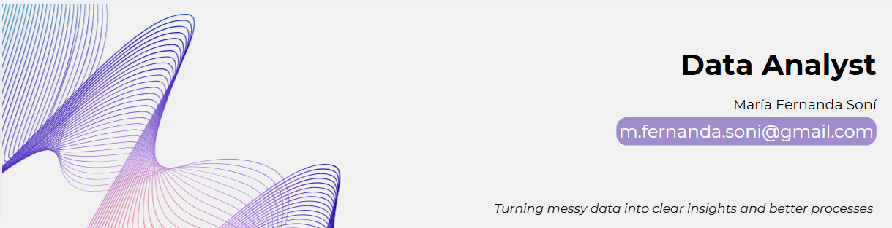

<h1 align="center">Hi, I'm María Fernanda 👋</h1>

  

  
  
  
  

---

## 👩‍💻 About me

I'm a **Data Analyst with a Mechatronics Engineering background** who turns messy operational data into clear decisions. I've worked inside manufacturing and customer quality operations at Softys, where I digitized paper-based tracking, built KPI dashboards and automated weekly reporting. Today I combine that process mindset with SQL, Python and BI tools.

- 📊 I build end-to-end analyses: data cleaning, statistical testing, dashboards and recommendations a team can act on
- 🏭 I know what data looks like on the shop floor and how to make it useful for the people who run it
- 🎓 Data Analyst Certificate from TripleTen (2026)
- 📍 Based in Mexico

> 🟢 **Open to work:** Data Analyst and Business Data Analyst roles, plus freelance projects such as dashboards, reporting automation, data cleaning and KPI tracking.

---

## 🛠️ Tech stack

**Languages and databases**

**Analysis and statistics**

**Visualization and BI**

**Automation and tools**

---

## 🚀 Featured projects

### 1. RappiPlus: From Data to Business Decisions
An end-to-end capstone that combines five data sources to evaluate a delivery subscription service: data quality, profitability, conversion funnel, cohort retention and an A/B test of a checkout redesign.

- 💰 Identified **$2.94M in net profit**, confirming the business is profitable
- 🔎 Pinpointed the main funnel bottleneck at **payment info (86.71% step conversion)**
- 🧪 Ran a two-proportion Z-test and **advised against shipping the checkout redesign** (p = 0.42), avoiding a change with no proven effect
- 🧹 Validated data quality: removed 100 duplicates and excluded 10 extreme outliers

`Python` `SQL (PostgreSQL)` `Power BI` `statsmodels`

[**View project →**](https://github.com/mfernandasoni/RappiPlus_from_data_to_business_decisions)

### 2. Process Control Across 7 Production Lines (Softys)
A real-world project that replaced paper-based audits with tablet forms, a real-time database and a Power BI dashboard on 7 diaper and training pants production lines.

- 📋 Digitized process tracking with **full traceability** and real-time data
- 📈 Analyzed **300+ critical process variables** to set operational baselines
- 🚨 Added automatic alerts for incomplete entries, then eliminated the paper process

`Google Sheets` `Google Apps Script` `Power BI`

[**View project →**](https://github.com/mfernandasoni/process-control)

➡️ More projects, including real estate and retail dashboards, funnel analysis and urban mobility, in my **[portfolio](https://mfernandasoni.github.io/)**.

---

## 🤝 Let's connect

Hiring for a data role, or need help with a dashboard, a report or messy data? I'd love to hear from you.

📧 [m.fernanda.soni@gmail.com](mailto:m.fernanda.soni@gmail.com) · 💼 [LinkedIn](https://www.linkedin.com/in/mariafernandasoni-data-analyst/) · 🌐 [Portfolio](https://mfernandasoni.github.io/)

<i>Turning messy data into clear insights and better processes</i>

